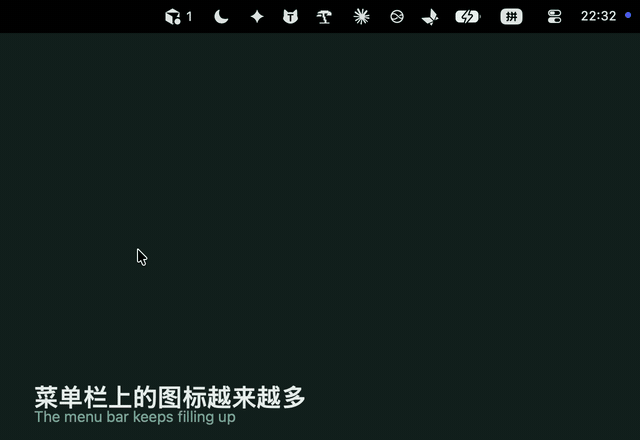
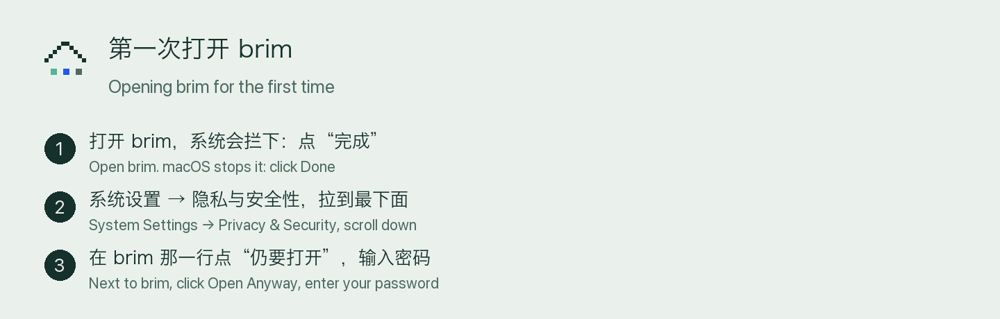

# sniai brim

Put your menu bar icons into boxes you set up yourself. Click a box and the icons inside are right there, menus included.



[中文说明](#中文)

## What it does

- **Boxes, your way.** Make a few boxes in the menu bar, give each one a look (eave, pine, stone lantern, fish, stone, network, tools, AI, drawer, work) and decide which icons live where. Apple's own icons stay put.
- **The menu bar never jumps.** Click a hidden icon inside a box and its menu opens right under that box. The icon doesn't flash back into the menu bar first.
- **Apps that only open from their own icon.** Some apps build their menu only when clicked, or open a panel instead of a menu (Claude, Outlook). brim lays a snapshot over the menu bar (this needs the optional Screen Recording permission; without it you'll see a brief flicker), lets the icon out underneath, and plays a short animation from the box to that spot while the app opens. You choose between two animations, *island* and *return*. If what opened turns out to be a readable menu, brim remembers that: from then on it opens that menu out of sight, reads it, and shows it right under the box like any other.
- **Calls come first.** While your camera or microphone is in use, every icon comes back so the system's call controls stay visible. Hiding resumes when the call ends.
- **Icons as you know them.** With the optional Screen Recording permission, boxes show each icon the way it looks in your menu bar instead of the app icon.
- English and Chinese, switchable in Settings.

## Requirements

- macOS 27 or later. Hiding uses macOS 27's menu bar restriction.
- brim must live in `/Applications`. Opened from anywhere else, the system can't tell brim's own boxes apart from other icons. brim offers to move itself.

## Install

1. Download the latest `Brim-x.y.z.dmg` from Releases, open it and drag brim into Applications. The window that opens shows these same steps.
2. brim isn't notarized yet, so the first time you open it macOS will stop it. This is expected:
   1. Open brim. macOS says it can't verify it: click **Done**.
   2. Go to **System Settings → Privacy & Security** and scroll to the bottom.
   3. Next to brim, click **Open Anyway** and enter your password. You only do this once.
3. Allow **Accessibility** when asked. brim opens the right settings page and shows you what to do. It uses Accessibility to read the menu bar icons and to open their menus for you. Screen Recording is optional.



To uninstall, quit brim (right-click a box › Quit brim) and delete the app. Your menu bar goes back to how it was as soon as brim quits.

## Privacy

- brim makes no network requests.
- Screen Recording, if you turn it on, captures only the thin menu bar strip. Captures stay on your Mac in `~/Library/Application Support/brim/menu-bar-icons/`.
- Settings are stored in your user defaults on this Mac.

## How hiding works, and what can break

brim asks the system to show only an allow-list of apps in the menu bar, using the private `MenuBarClientCore` framework. Nothing on disk is changed, no system process is restarted, and if brim quits or crashes the menu bar restores itself. Because the framework is private, a macOS update can break hiding; brim then keeps working as a launcher and tells you hiding is unavailable. It also means brim can't be on the Mac App Store.

The system hides by app, so all icons of one app hide or show together.

## Build from source

You need Xcode.

```bash
./scripts/build_and_run.sh        # build, sign with your Apple Development certificate if you have one, install to /Applications, open
swift test
./scripts/release.sh              # build/Brim-<version>.zip, the .dmg with the install guide, and their SHA-256
```

`BrimKit` has two extension points in `Sources/BrimKit/Extensions.swift`: `BoxAccessory`, an extra section under a box's icons, and `BoxGlyph`, an extra look for a box.

## License

Code: MIT, © 2026 lblus. The name *sniai brim*, the app icon and the box designs are not covered by the MIT license; see [BRAND.md](BRAND.md).

---

## 中文

菜单栏上的图标，按你自己的习惯收进几个收纳格。点开一格，里面的图标连同它们的菜单都在手边。


### 能做什么

- **收纳格自己建。** 建几个格子，每个挑一个样子（帽檐、松、石灯笼、鱼、石头、网络、工具、AI、抽屉、工作），再决定每个图标放进哪一格。苹果自己的图标不动。
- **菜单栏不跳。** 在收纳格里点一个藏着的图标，它的菜单直接从这一格下面弹出来，图标不用先回到菜单栏上闪一下。
- **只认自己图标的 app。** 有的 app 点了才生成菜单，或者弹的是面板不是菜单（Claude、Outlook）。brim 先给菜单栏拍一张照片盖住（要可选的“屏幕录制”权限，没开的话这一下会闪），在底下让它露出来，再用一段动画把“从收纳格到它那里”演出来，它就从那里弹出。动画有“岛”和“归位”两种，在设置里选。如果弹出来的是一份读得出来的菜单，brim 会记住：以后在你看不到的地方点开、读出来，直接从收纳格下面弹，和别的图标一样。
- **通话优先。** 摄像头或麦克风在用时，所有图标暂时回到菜单栏，系统的通话控件不会被藏掉；通话结束自动收回。
- **图标还是熟悉的样子。** 打开可选的“屏幕录制”后，收纳格里显示图标在菜单栏上本来的样子，而不是应用的大图标。
- 中文、English，在设置里切换。

### 需要

- macOS 27 或更高版本（隐藏靠 macOS 27 的菜单栏显示限制）。
- brim 要放在“应用程序”文件夹里：从别处打开时，系统分不清哪个是 brim 自己的收纳格。不在的话 brim 会问要不要挪过去。

### 安装

1. 在 Releases 下载最新的 `Brim-x.y.z.dmg`，打开后把 brim 拖进“应用程序”。打开的那个窗口上就印着下面这几步。
2. brim 还没有经过苹果公证，第一次打开会被系统拦下，这是正常的：
   1. 打开 brim，系统提示无法验证：点“完成”。
   2. 打开“系统设置 → 隐私与安全性”，拉到最下面。
   3. 在 brim 那一行点“仍要打开”，输入密码。只用做这一次。
3. 按提示打开“辅助功能”：brim 会替你打开那一页设置，并在旁边告诉你怎么做。brim 靠它读出菜单栏上有哪些图标、替你打开它们的菜单。“屏幕录制”可以不开。


卸载：右键任意一个收纳格 › 退出 brim，再删掉 app。brim 一退出，菜单栏就回到原来的样子。

### 隐私

- brim 不联网。
- 打开“屏幕录制”后，只截菜单栏那一小条，截图只存在这台电脑的 `~/Library/Application Support/brim/menu-bar-icons/`。
- 设置存在这台电脑的用户设置里。

### 怎么藏的，什么时候会坏

brim 通过私有框架 `MenuBarClientCore` 告诉系统“菜单栏上只显示这些应用”，不改任何文件、不重启任何系统进程；brim 退出或崩溃时，菜单栏自动还原。因为是私有框架，系统更新后隐藏可能失效，这时 brim 照常能用来打开图标，并告诉你暂时藏不了。也因为这个，brim 上不了 Mac App Store。

系统按应用藏：同一个应用的几个图标一起藏、一起露。

### 自己编译

需要 Xcode。命令见上面英文部分的 “Build from source”。

### 许可

代码用 MIT 许可，版权归 lblus。名称 sniai brim、App 图标和收纳格的样子不在 MIT 许可范围内，见 [BRAND.md](BRAND.md)。
